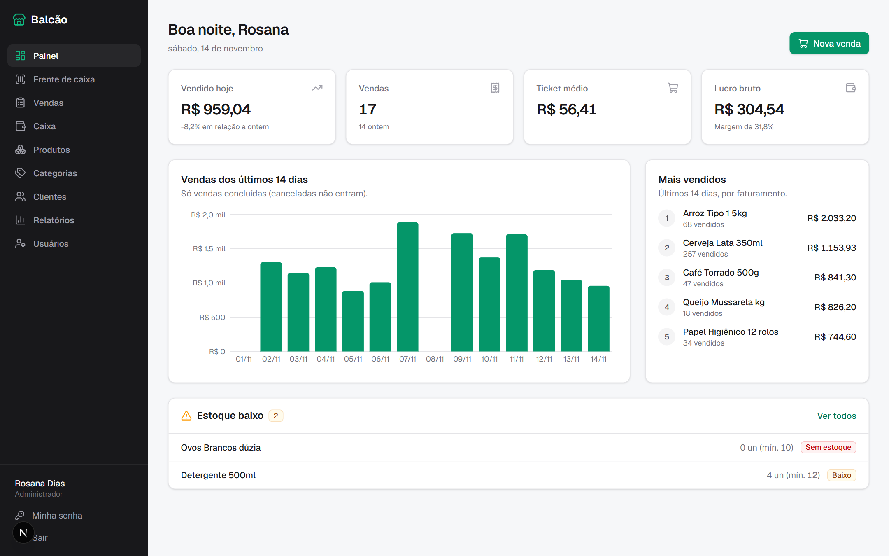
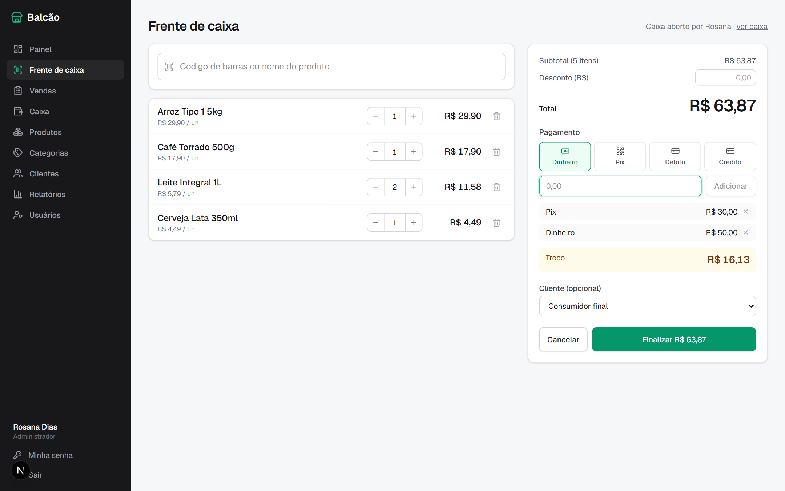
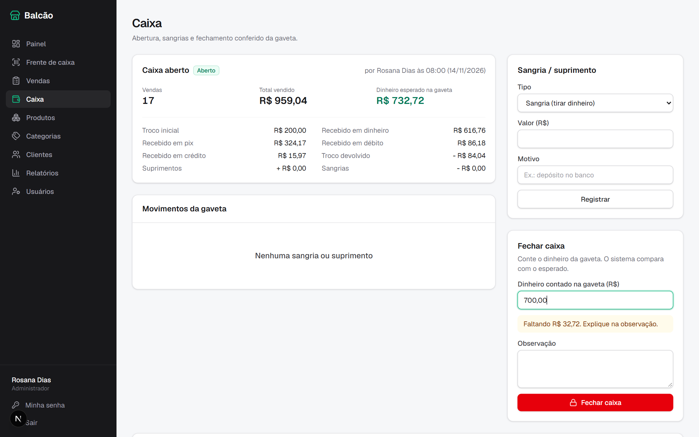

# Balcão

Sistema de gestão para pequeno comércio (mercearia, conveniência, loja de bairro): frente de caixa,
controle de estoque com histórico, abertura e fechamento de caixa, clientes e relatórios.

Feito com **Next.js 16 (App Router) + TypeScript + PostgreSQL (Prisma 7)**, testado com **Vitest**
contra um Postgres de verdade e empacotado com **Docker**.



## O que dá para fazer

- **Frente de caixa (PDV):** busca por nome ou leitor de código de barras (o leitor "digita" o código e dá Enter), carrinho, desconto, pagamento dividido (Pix + dinheiro, por exemplo) e cálculo de troco.
- **Estoque:** cada entrada, saída, ajuste de inventário, venda e cancelamento vira uma linha no histórico com o saldo depois do movimento. Ninguém altera o saldo "na mão". Alerta de estoque baixo e uma previsão de quantos dias o produto ainda dura.
- **Caixa:** abertura com troco inicial, sangria e suprimento, fechamento conferindo o dinheiro contado contra o esperado. Se der diferença, o sistema pede uma justificativa.
- **Vendas:** lista com filtros, comprovante para imprimir e cancelamento com motivo, que devolve os itens ao estoque.
- **Relatórios:** faturamento, ticket médio, lucro bruto e margem, vendas por dia, por forma de pagamento, por categoria e por vendedor, produtos mais vendidos e exportação em CSV (abre direto no Excel).
- **Usuários e permissões:** administrador faz tudo. Vendedor vende, abre e fecha o caixa e dá entrada de mercadoria, mas não mexe em preço, não cancela venda e não vê relatórios.

| Frente de caixa | Fechamento de caixa |
|---|---|
|  |  |

## Decisões que vale explicar

**Dinheiro em centavos.** Todo valor é `Int` em centavos, do banco até a tela. Com `float`,
`0,1 + 0,2` dá `0,30000000000000004`, e isso não pode existir num caixa.

**A tela não manda preço.** O PDV envia só `produtoId` e quantidade. O servidor busca os preços
no banco e refaz a conta com a mesma função usada na tela (`calcularVenda`, em
`src/lib/dominio/venda.ts`). Alterar o preço no navegador não adianta nada.

**Venda numa transação só, sem estoque negativo.** Fechar a venda grava a venda, os itens, os
pagamentos, a baixa de estoque e o histórico dentro de uma única transação. A baixa usa
`UPDATE ... WHERE estoque >= quantidade`. Se dois caixas venderem o último item ao mesmo tempo,
um deles falha e a transação inteira é desfeita. Existe um teste que dispara três vendas
simultâneas do último item e confere que só uma passa.

**Regras garantidas pelo banco, não só pelo código.** Na migração `um_caixa_aberto` tem:
- um índice único *parcial* (`WHERE status = 'ABERTO'`), para que nunca existam dois caixas abertos, mesmo com dois cliques ao mesmo tempo;
- `CHECK` para estoque e valores nunca ficarem negativos.

O Prisma não gera esse tipo de índice pelo schema, então ele foi escrito direto no SQL.

**Sessão no banco.** O login cria um token aleatório. O cookie é `httpOnly` e no banco fica só o
**hash** do token, então se o banco vazar ninguém consegue usar as sessões. Trocar a senha
derruba as outras sessões, e desativar um usuário o desloga na hora. As senhas usam bcrypt e o
login tem limite de tentativas.

**Onde a permissão é checada.** O `proxy.ts` (o antigo middleware) faz só um filtro rápido: sem
cookie, vai para o login. A checagem de verdade fica em `src/lib/dal.ts` e roda em toda página
e em toda action do servidor. Nada confia no menu escondido.

**Next 16 com Cache Components.** Cada página entrega a "casca" na hora e o conteúdo, que depende
do usuário e do banco, chega por streaming dentro de um `<Suspense>`. No build, todas as telas
aparecem como *Partial Prerender*.

**Fuso horário.** "Vendas de hoje" usa o dia de Brasília, não o de UTC. Sem isso, uma venda às
22h cairia no dia seguinte. Tem teste para isso.

## Estrutura

```
src/
  app/
    login/                 tela de login e ações de entrar/sair
    (loja)/                tudo que exige login (layout com o menu)
      painel/ pdv/ vendas/ caixa/ produtos/ categorias/ clientes/ relatorios/ usuarios/ conta/
  lib/
    dominio/               regras puras (sem banco): venda, estoque, caixa, relatórios, CPF/CNPJ
    servicos/              regras que usam o banco: vendas, caixa, produtos, usuários, relatórios
    dal.ts                 quem está logado e o que pode fazer
    sessao.ts              cookie de sessão
  components/              UI reaproveitada (Tailwind, sem biblioteca de componentes)
prisma/
  schema.prisma            modelo de dados
  migrations/              migrações (inclui o índice parcial e os CHECKs)
  seed.ts                  mercearia de exemplo com 30 dias de vendas
tests/                     testes de integração dos serviços com Postgres real
```

## Rodando

### Com Docker (mais fácil)

```bash
docker compose up --build
```

O serviço `seed` aplica as migrações e coloca os dados de exemplo. Depois, abra
http://localhost:3000.

### Para desenvolver

Precisa de Node 20 ou mais novo e de um Postgres. Dá para subir só o banco com
`docker compose up db`.

```bash
cp .env.example .env
npm install
npx prisma migrate dev
npm run db:seed
npm run dev
```

Contas de demonstração (senha `demo1234`):

| E-mail | Papel |
|---|---|
| `admin@balcao.dev` | administrador |
| `vendedor@balcao.dev` | vendedor |

## Testes

```bash
npm test
```

São 40 testes:

- **Unidade** (`src/lib/dominio`): troco, desconto máximo por papel, movimentos de estoque, fechamento de caixa, dia no fuso de Brasília, CSV, CPF/CNPJ.
- **Integração** (`tests/`): rodam os serviços contra um banco separado (`balcao_teste`). Cobrem concorrência (último item disputado, cancelamento duplo, dois cliques em "abrir caixa"), permissões de desconto, sessão derrubada ao trocar senha e relatórios.

A CI (GitHub Actions) sobe um Postgres, roda lint, checagem de tipos, os testes e o build de
produção.

## Stack

Next.js 16 · React 19 · TypeScript · Tailwind CSS 4 · PostgreSQL 17 · Prisma 7 · Zod · bcrypt ·
Recharts · Vitest · Docker · GitHub Actions
